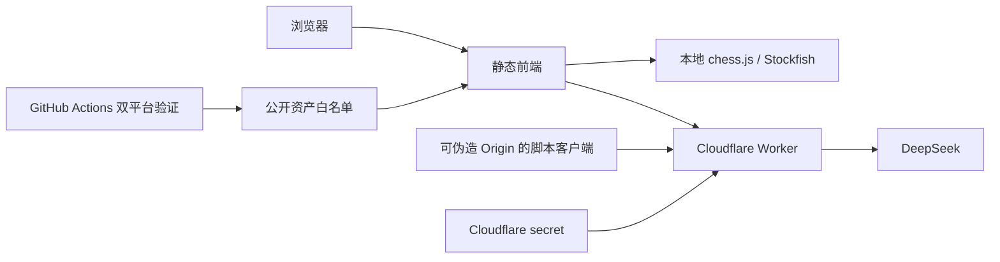

# ChesSight 威胁模型

更新：2026-10-29。代码与本地验证证据见 [AUDIT_REPORT.md](./AUDIT_REPORT.md)。本文件覆盖仓库内前端、单个 Cloudflare Worker、本地服务器、CI 与分发资产；不把账户控制台配置或历史审计假设当作已验证事实。

## 系统与信任边界

- 静态前端：GitHub Pages / `chessight.art` 分发本地 ES Modules、棋子素材和 Stockfish WASM，无登录、数据库或框架。
- 规则与分析：chess.js 校验走子与完成摆棋；自由摆棋阶段允许临时非法位置。引擎首屏后台预热，同源 `engine-worker.js` 让实际 Worker 读取版本化 WASM 缓存。
- 浏览器 → `/`：SAN、FEN、最后一着及有限枚举字段，经 Worker 转发 DeepSeek 解说。默认开启且页面披露，可关闭。
- 浏览器 → `/recognize`：仅内存压缩图片经 Worker 转发 DeepSeek；返回盘面和回合建议后必须人工校对。退出或编辑时取消请求；图片不写 localStorage、IndexedDB 或 Cache Storage，退出清除预览。
- 公网 → Worker：匿名客户端可伪造 Origin。CORS 是浏览器边界，不是认证；本地 Map 限流不是全局费用保护。
- Worker → DeepSeek：上游 URL、模型和 token 预算固定，Authorization 仅由 Cloudflare secret 注入，不来自请求字段。
- 工作区 → 本地服务器：仅监听 `127.0.0.1`，仅公开 index/manifest/assets/css/js；解析错误受控返回，符号链接真实目标也必须处于公开路径。
- 仓库 → CI → Pages：验证 job 只有 `contents: read`；deploy job 额外持有 `pages: write` / `id-token: write`。Ubuntu、Windows 均通过后才发布。仅打包公开前端和许可资料，不上传仓库根目录全部内容。

## 资产与安全目标

| 资产 | 目标 |
|---|---|
| DeepSeek secret、可计费额度 | 凭据保密，限制滥用与资源消耗 |
| 前端与 vendor 资产 | 防止供应链漂移或不可信脚本执行 |
| 棋局状态、模型返回 | 防止过期异步结果覆盖新局面；模型文本仅作为文本呈现 |
| 图片、棋谱、FEN | 仅为已披露功能发送；不进入持久化存储或日志 |
| 本地环境文件与 Git 元数据 | 不经开发服务器或 Pages 产物公开 |

## 已实现的控制

| 边界 | 控制与代码证据 |
|---|---|
| Worker 路由与公共输入 | 仅 `/`、`/recognize`；Origin/方法/Content-Type/secret 预检；未知路径 404。`worker/src/index.js` |
| 解说输入 | 8KiB 流式字节上限、字段白名单、SAN/FEN 结构、已知开局、400 半着上限；每 IP 每 isolate 30 次/分钟。`validatePayload`、`locallyRateLimited` |
| 图片输入与模型结果 | 4MB 请求体、data URL/base64 校验、独立 `rec:` 前缀 10 次/分钟；pieces 清单经 `placementFromPieces` 确定性转为棋盘段。`handleRecognize` |
| 上游截止与清理 | 解说 15 秒覆盖响应头和首个非空响应体块，心跳同样算数据；此后跟随客户端断连。识别 120 秒覆盖完整 JSON body；失败响应取消 body。`startUpstreamStream`、`handleRecognize` |
| 客户端资源 | 解说串行队列上限、总/空闲截止、有限重试；清理不等待挂起的 cancel。识别支持外部 AbortSignal、一次瞬态重试，取消/4xx 不重试。`js/commentary.js`、`js/recognition.js` |
| 前端状态 | FEN 与操作版本共同校验引擎结果、进度、失败和动画；识别以独立请求身份校验退出/重入；手工编辑取消识别。`js/main.js` |
| DOM 与 CSP | 模型文本只写 `textContent`；本地脚本/字体/图片；图片允许 data:；固定 Worker 域名与 CSP 一致性测试。`index.html`、`tests/static-policy.test.js` |
| 日志 | 仅事件、请求 ID、状态、耗时和受限原因；不记录 secret、IP、payload、FEN 或图片。`logEvent`、Worker 安全测试 |
| vendor | chess.js 1.4.0、Stockfish.js 18.0.0 与 12 个棋子 SVG 共 15 个固定 SHA-256；WASM magic 与 SVG 安全检查。来源和许可见 `VENDOR.md` |
| 开发与发布 | loopback + 路径/realpath 白名单；环境变体 gitignored；Actions 固定完整 SHA、公开产物 staging。`scripts/serve.mjs`、`.github/workflows/ci.yml` |

## 剩余风险及边界

| ID | 风险 | 当前控制与剩余工作 |
|---|---|---|
| TM-001 | 匿名脚本消耗付费 API 额度（高） | CORS 可伪造、isolate 限流可被分散请求绕过。账户级 WAF/Rate Limiting、费用告警/熔断是否已配置尚无证据；本轮未修改账户设置。 |
| TM-002 | 开发者绕过自带服务器暴露工作区（中） | README 禁止根目录通用服务器；自带服务器含畸形 URL 和符号链接实测。恶意本地进程可改文件，超出 loopback 服务器的隔离边界。 |
| TM-003 | 合法格式但矛盾的 SAN/FEN 误导模型（中） | Worker 只做结构与字段校验，不重放完整棋谱；无法改变固定上游 URL/secret。费用防护仍应在账户层完成。 |
| TM-004 | 上游资产或有提交权限的账户被接管（高） | 哈希门只能发现未审阅漂移。当前 Stockfish JS/WASM 来源差异已闭环；后续升级仍须核对官方源和哈希 diff，不自动信任新版本。 |
| TM-005 | 模型内容错误（中） | `textContent` 防执行；识别结构有效不等于棋子位置正确。本次真实旋转图出现 g2→h2 错位且 uncertain 为空，必须逐格人工校对。 |
| TM-006 | 网络/上游或引擎挂起（低到中） | 客户端截止/队列恢复已测试。引擎排队搜索没有外部 stop API，过期结果会丢弃，但可能占用一个搜索周期。Worker 解说首数据后不设正文总截止，浏览器总/空闲截止是当前正常用户路径的保护。 |
| TM-007 | 后续维护引入敏感日志（中） | 当前日志 schema 与负向测试不含敏感字段；日志保留时长、账户读取权限仍属平台配置边界。 |

## 验证范围说明

实验请求经用户授权直连 DeepSeek；密钥仅由请求进程从被忽略的本地文件读取，没有输出到日志、argv 或提交产物。图片与请求体只在内存中处理；磁盘棋盘测试图为合成测试资料。实验详情见 `RECOGNITION_BENCHMARK.md` 与 `RECOGNITION_OPTIMIZATION.md`，生产发布证据以 `AUDIT_REPORT.md` 为准。vendor 按固定哈希和加载行为核验，未修改或逐行重审压缩 glue / WASM 内部算法，也未重新开展完整上游漏洞情报扫描。历史报告中的供应链“来源未知”阻断不再适用于当前文件。
